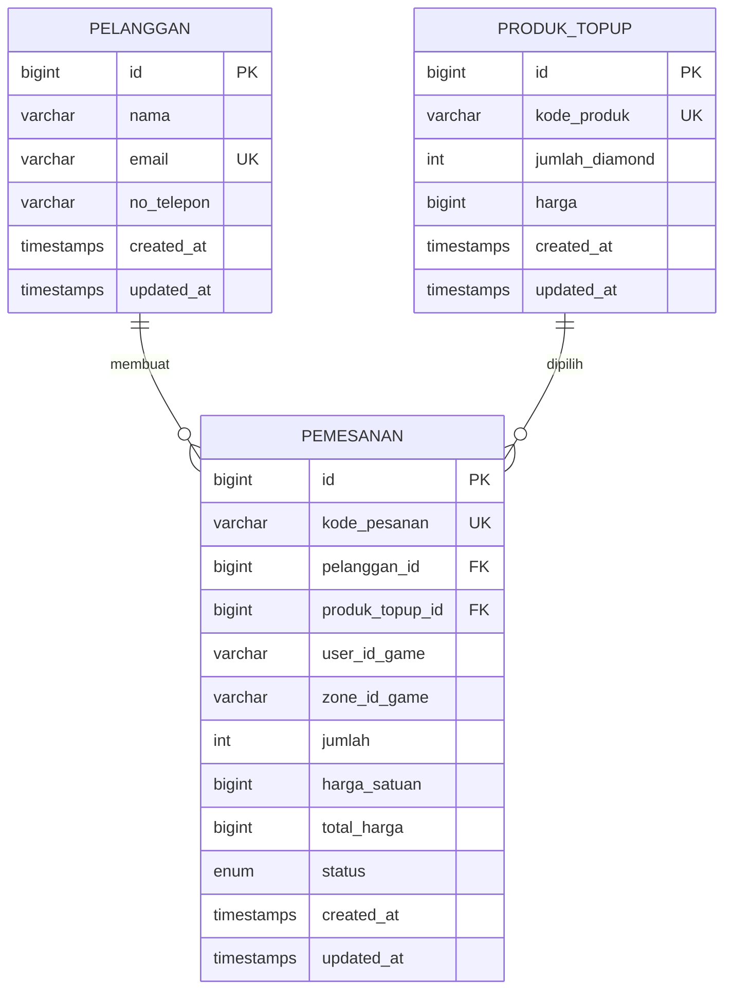

# Aplikasi Manajemen Top Up Game

Aplikasi Laravel untuk menampilkan form pemesanan top up serta mengelola data pemesanan, pelanggan, dan produk top up.

## Rancangan ERD

Satu pelanggan atau produk dapat memiliki banyak pemesanan. Harga satuan dan total disimpan pada pemesanan; total dihitung otomatis dari harga produk dan jumlah paket. Pelanggan dan produk yang sudah digunakan dalam pemesanan tidak dapat dihapus.

## Menjalankan aplikasi

1. Install dependency: `composer install`
2. Salin `.env.example` menjadi `.env`, lalu atur koneksi database.
3. Buat application key: `php artisan key:generate`
4. Jalankan migrasi dan data contoh: `php artisan migrate --seed`
5. Jalankan aplikasi: `php artisan serve`

Konfigurasi default memakai SQLite. Atur `DB_CONNECTION` dan variabel database terkait di `.env` bila menggunakan MySQL.

Seeder tiap tabel tersedia secara terpisah di `database/seeders`: `PelangganSeeder`, `ProdukTopUpSeeder`, dan `PemesananSeeder`. `DatabaseSeeder` menjalankannya sesuai urutan dependensi. Untuk menjalankan seeder tertentu, gunakan `php artisan db:seed --class=PelangganSeeder` (ganti nama class sesuai seeder).

## Halaman aplikasi

- `/skinku` menampilkan form pemesanan top up (`/` mengarah ke halaman ini). Produk yang tersedia di form ini berasal dari tabel produk top up.
- `/pemesanan`, `/pelanggan`, dan `/produk-topup` menyediakan CRUD masing-masing tabel.
- Pemesanan dari halaman awal akan menyimpan data pelanggan (berdasarkan email) dan pemesanannya.
- Data pelanggan atau produk yang sudah dipakai dalam pemesanan tidak dapat dihapus.

Setiap form memiliki validasi, dan pesan keberhasilan atau kesalahan ditampilkan pada halaman.

Jalankan pengujian dengan `php artisan test`.
